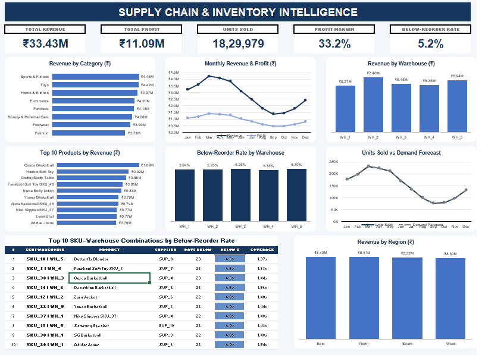
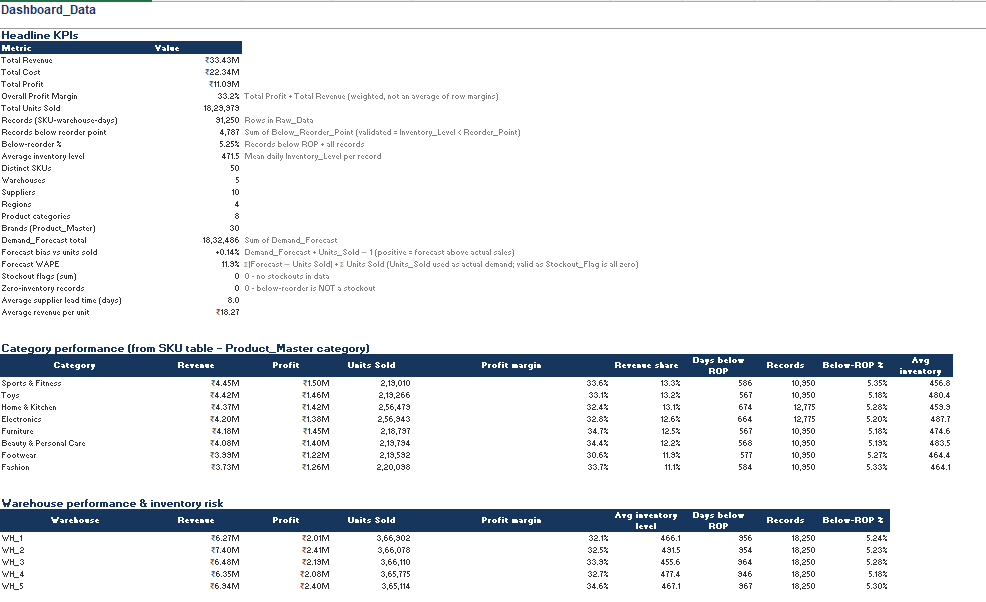

# 📦 Supply Chain & Inventory Intelligence

<p align="center">
  
  
  
  
  
</p>

## 📌 Overview

A data-driven Supply Chain & Inventory Intelligence project designed to analyze **91,250+ supply chain records** and transform operational data into actionable business insights.

The project combines Python-based data processing, PostgreSQL data management, advanced SQL analytics, and Excel dashboards to investigate revenue performance, inventory health, warehouse efficiency, and demand forecasting patterns.

## 🎯 Business Objectives

- Analyze revenue and profitability across products, categories, and warehouses.
- Identify inventory items falling below their reorder thresholds.
- Understand warehouse-level operational and financial performance.
- Investigate demand and forecast deviations across products.
- Translate raw operational data into actionable business intelligence.

## 🛠️ Tech Stack

| Technology | Purpose |
|-----------|---------|
| Python | Data processing and analysis |
| Pandas | Data cleaning, transformation, and enrichment |
| PostgreSQL | Structured data storage |
| SQL | Business analysis and inventory intelligence |
| Microsoft Excel | PivotTables, KPI analysis, and dashboards |

## 🔄 Project Workflow

```text
Raw Supply Chain Data
        ↓
Python & Pandas
        ↓
Data Cleaning and Enrichment
        ↓
Product Master Integration
        ↓
PostgreSQL Database
        ↓
Advanced SQL Analytics
        ↓
Business Insights
        ↓
Excel Dashboard & Visualization
```

## 📊 Key Analyses

### 1. Revenue & Profitability Analysis
- Evaluated revenue and profit contribution across products and categories.
- Compared category-level financial performance.
- Identified high-performing and low-performing product categories.

### 2. Warehouse Performance Analysis
- Compared revenue contribution across warehouses.
- Investigated warehouse-level inventory distribution.
- Identified warehouses with comparatively higher and lower revenue.

### 3. Inventory Intelligence
- Evaluated inventory levels against reorder points.
- Identified SKU-warehouse combinations below reorder thresholds.
- Analyzed inventory risk distribution across products and warehouses.

### 4. Demand & Forecast Analysis
- Compared demand and forecast values across 50 SKUs.
- Examined overforecasting and underforecasting patterns.
- Investigated directional forecasting deviations.

### 5. Product & Category Insights
- Analyzed product-level and category-level performance.
- Evaluated revenue contribution across categories.
- Identified categories with comparatively stronger and weaker financial performance.

## 📈 Key Business Insights

| Metric | Result |
|-------|-------|
| Records Analyzed | 91,250+ |
| Total Revenue | ₹33.43M |
| Total Profit | ₹11.09M |
| Product SKUs | 50 |
| Highest Revenue Category | Sports & Fitness |
| Sports & Fitness Revenue Share | 13.32% |
| Lowest Revenue Category | Fashion |
| Fashion Revenue Share | 11.15% |

### Warehouse Insights
- WH_2 recorded the highest revenue contribution.
- WH_1 recorded the lowest revenue contribution.

### Forecast Directional Analysis
- 34 SKUs were overforecasted.
- 16 SKUs were underforecasted.
- 68% of analyzed SKUs exhibited overforecasting.
- 32% exhibited underforecasting.

*Note: These figures represent forecast deviation direction, not forecast accuracy.*

## 📊 Excel Dashboard

The project includes Excel-based dashboards presenting financial performance, product insights, warehouse analysis, and inventory intelligence.

### Dashboard Preview

<p align="center">
  
</p>

<p align="center">
  
</p>

## 📁 Project Structure

```text
Supply-Chain-Inventory-Intelligence/
│
├── data/
│   ├── Raw_Data
│   └── Product_Master
│
├── python/
│   └── data_processing.py
│
├── sql/
│   ├── revenue_analysis.sql
│   ├── inventory_analysis.sql
│   ├── warehouse_analysis.sql
│   └── other_analytics.sql
│
├── screenshots/
│   ├── dashboard-1.png
│   └── dashboard-2.png
│
├── Supply_Chain_Intelligence_Analysis.xlsx
├── README.md
└── requirements.txt
```

## 🚀 Future Enhancements

- Inventory demand forecasting using machine learning.
- Automated reorder quantity recommendations.
- Interactive dashboard enhancements.
- Supplier performance and lead-time optimization.
- Inventory risk monitoring and alerting.

## 💡 Business Impact

This project demonstrates how data analytics can support supply chain decision-making through:

- Improved visibility into inventory health.
- Data-driven revenue and profitability analysis.
- Identification of inventory items below reorder thresholds.
- Warehouse performance comparison.
- Forecast deviation analysis.
- Consolidated business intelligence reporting.

## 👨‍💻 Author

**Faraz Kazi**

B.E. Artificial Intelligence & Data Science

Mumbai, India

- GitHub: [Faraz-05](https://github.com/Faraz-05)
- LinkedIn: [farazkazi](https://linkedin.com/in/farazkazi)

---

<p align="center">
  <b>Turning Supply Chain Data into Actionable Business Intelligence.</b>
</p>
